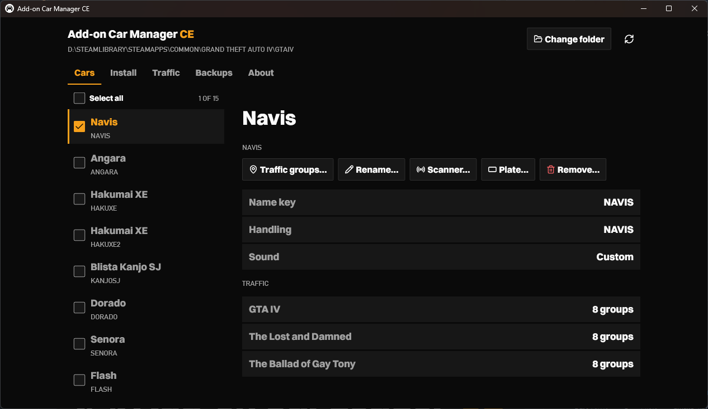
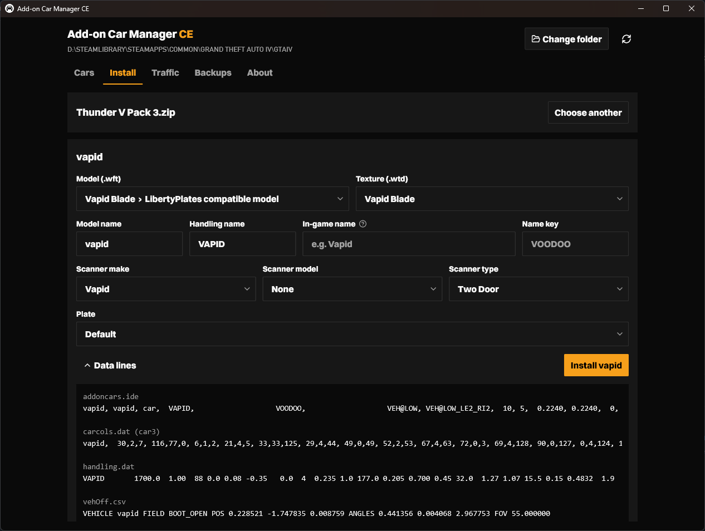
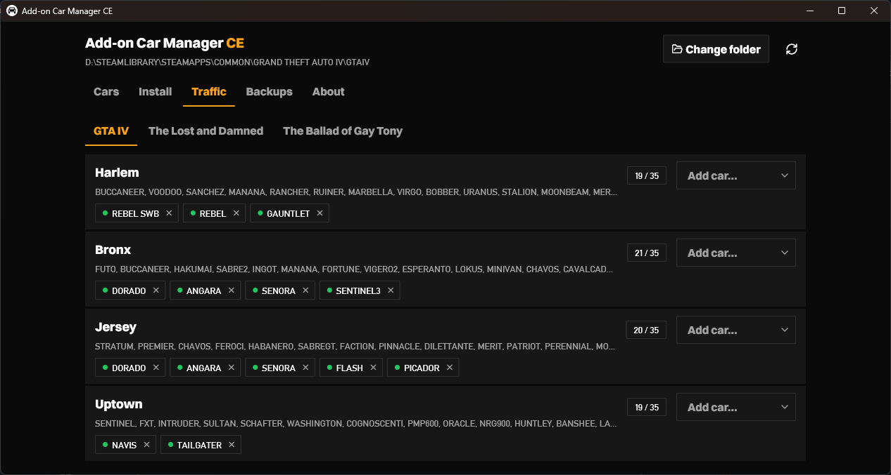
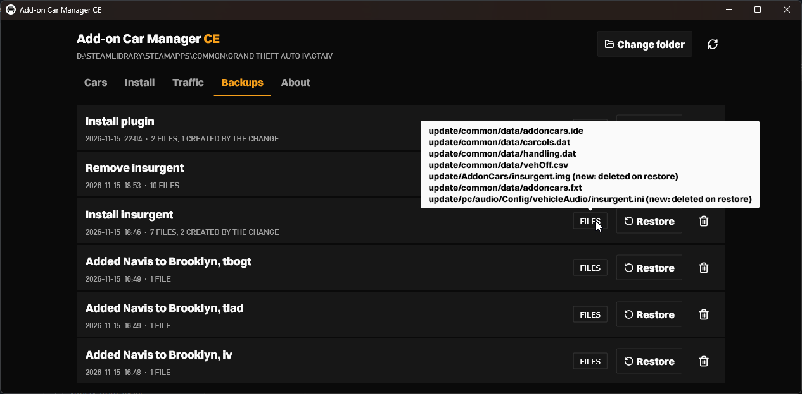

# Add-on Car Manager CE

Every change is written under `update\` and backed up first.

## Startup

- Finds the game through the registry and Steam libraries; asks which install to use.
- Warns about a game version other than 1.2.0.59, missing FusionFix (with a link), and a missing
  `AddonCarLoaderCE.asi` (with a one-click install).

## Cars

Installed add-on cars. Ctrl/Shift-click or the tick boxes select several; actions apply to the
selection.

- **Traffic groups**: tick the areas the car spawns in, per episode. Can copy another car's groups.
- **Rename**: in-game name, and the name key (8 characters; cars sharing a key share a name).
- **Scanner**: what the police radio calls the car. Cars with their own sound file only.
- **Plate**: LibertyCityPlates plate type, with the real odds of each plate the car ends up with.
- **Remove**: deletes the car's lines, archive, sound file and traffic entries.

A red mark means the car is missing something (archive, colours, handling, camera lines).

## Install

Open or drop a `.zip`, `.7z` or `.rar`. Data lines are read from the readme; each car in the
archive gets a panel. The archive stays open, so a pack installs car by car.

- **Model / Texture**: pick a variant. The LibertyPlates model is the default when that mod is installed.
- **Model name / Handling name**: change them when they clash with a vanilla or installed car.
- **In-game name / Name key**: leave the name empty to keep a borrowed vanilla name.
- **Sound from**: shown when the mod ships no sound; clones a vanilla or installed car's.
- **Scanner**, **Plate**: as on the Cars tab.
- **Data lines**: exactly what will be written, per file.

An archive with only `.wft`/`.wtd` for a vanilla model installs as a new car; the missing lines
come from the game's own files.

## Traffic

The 47 traffic groups of each episode, with their car count against the game's limit of 35.
Add-on cars show as chips: add from the dropdown, remove with the ×.

## Backups

One entry per change, newest first. **Files** lists what it touched, **Restore** puts those files
back (and backs up the current state first).

## About

Licenses of everything shipped, and the update check (manual, or on startup).
